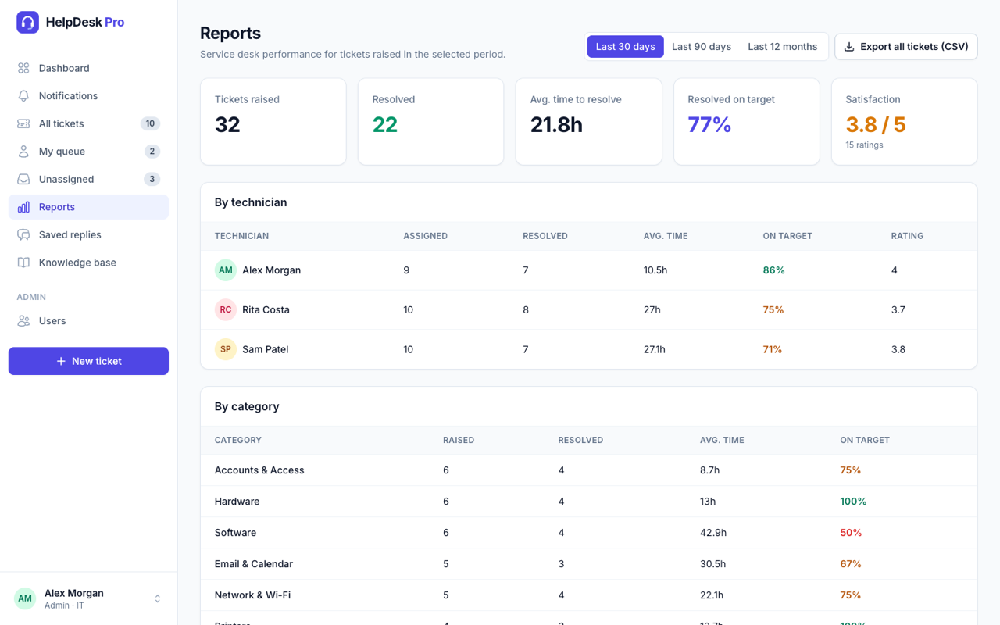
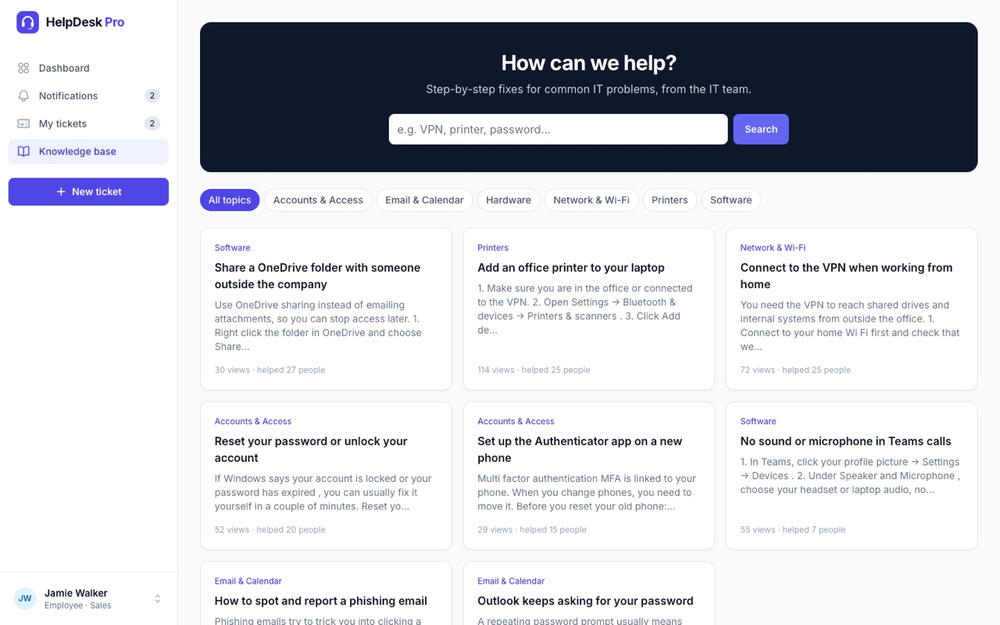

# HelpDesk Pro

[](https://github.com/FPires99/helpdesk-pro/actions/workflows/tests.yml)

An IT service desk where employees raise support tickets and the IT team works the queue. It has priority-based target times, a self-service knowledge base, email notifications, reporting and a REST API.

Built with **Laravel 12**, **Blade**, **Tailwind CSS** and **Alpine.js**, and covered by 90+ automated feature tests that run on every push.


## Try it

The login page has one-click demo accounts. All demo users use the password `password`, and the demo data resets every night.

| Role | Email | What they can do |
| --- | --- | --- |
| Employee | `employee@helpdesk.test` | Raise tickets, reply, rate the support, use the knowledge base |
| Technician | `tech@helpdesk.test` | Work the whole queue, assign, internal notes, saved replies, reports, write articles |
| Admin | `admin@helpdesk.test` | Everything a technician can do, plus user management and deleting tickets |

## Features

### For employees
- **Raise tickets** with a priority guide ("How urgent is it?") and **attachments** (screenshots, PDFs, logs).
- **Knowledge base suggestions while typing**: start typing "VPN not connecting" and the matching how-to article appears *before* the ticket is sent, so many problems are fixed without waiting for IT.
- **Email and in-app notifications** when IT replies, needs information, or resolves the ticket.
- **Rate the support** (1–5 stars) once a ticket is resolved.
- Replying to a resolved ticket **reopens** it automatically.

### For the IT team
- **Queue views**: all tickets, my queue, unassigned; search by text or ticket number (`HD-0042`); filter by status, priority and category.
- **Priority-based target times (SLA)**: urgent 2h, high 8h, medium 24h, low 72h. Overdue tickets are flagged, and the clock pauses while waiting on the user.
- **Activity history** on every ticket: who changed status, priority, assignee or category, and when.
- **Internal notes** (and internal attachments) the requester never sees.
- **Saved replies** with placeholders (`{name}`, `{ticket}`, `{agent}`), inserted from the reply box.
- **"Assign to me"** in one click; notifications when a ticket is assigned to you.
- **Dashboard**: active, unassigned and overdue counts, average resolution time, % on target, satisfaction, new tickets per day and tickets by category.
- **Reports** by technician, category, priority and month, plus **CSV export** of any filtered ticket list.
- **Knowledge base editor** with Markdown, drafts, view counts and "this fixed it" votes.

### For admins
- **User management**: add users (they get an email link to set their password), change roles and departments.
- **Leaver process**: deactivating an account signs the user out immediately, blocks future sign-in, and returns their open tickets to the queue while keeping history.
- **Last sign-in** shown for every account, to spot unused accounts.

## Screenshots

| Ticket queue | Ticket conversation with history |
| --- | --- |
|  |  |

| Knowledge base suggestions while raising a ticket | Reports |
| --- | --- |
|  |  |

| Knowledge base | Sign in with demo accounts |
| --- | --- |
|  |  |

## REST API

Create a token on your **Profile** page, then send it as a bearer token. The API uses the same permissions, validation and notifications as the web app, and is limited to 60 requests per minute.

| Method | Endpoint | Description |
| --- | --- | --- |
| `GET` | `/api/v1/me` | The authenticated user |
| `GET` | `/api/v1/tickets` | List tickets you can see. Filters: `status` (`active` or a status), `priority`, `assignee=me`, `per_page` |
| `POST` | `/api/v1/tickets` | Raise a ticket: `subject`, `category_id`, `priority`, `description` |
| `GET` | `/api/v1/tickets/{id}` | One ticket with its conversation (internal notes only for staff) |
| `PATCH` | `/api/v1/tickets/{id}` | Staff only: `status`, `priority`, `assignee_id`, `category_id` |
| `POST` | `/api/v1/tickets/{id}/comments` | Reply: `body`, `is_internal` (staff only) |

Example: a monitoring script raising an urgent ticket:

```bash
curl -X POST https://your-helpdesk.example/api/v1/tickets \
  -H "Authorization: Bearer $TOKEN" -H "Accept: application/json" \
  -d subject="Disk space low on FILESERVER01" -d category_id=1 \
  -d priority=urgent -d description="C: drive at 97% (alert from monitoring)"
```

## Security

- **Authorisation on every request** through [policies](app/Policies) and role middleware; employees can never load another person's ticket, attachment or internal note, whether through the web or the API.
- **Uploads** are type- and size-checked, stored outside the public folder and only served after a permission check.
- **Login is rate-limited** (5 failed attempts locks the account for a minute); sign-up and the API are rate-limited too.
- **Deactivated accounts** are signed out immediately and can't sign in or use API tokens.
- **Security headers** on every response: Content Security Policy, `X-Frame-Options`, `X-Content-Type-Options`, `Referrer-Policy`, and HSTS over HTTPS.
- **Output escaping** everywhere; knowledge base Markdown is rendered with raw HTML stripped. The CSV export neutralises spreadsheet formulas (CSV injection).
- **Demo safety**: the shared demo accounts can't have their password or email changed, and the demo database resets nightly.
- **Dependency audits** (`composer audit`, `npm audit`) run in CI on every push.

## Deploying a demo

The repo includes a [`Dockerfile`](Dockerfile) and a [`render.yaml`](render.yaml) blueprint for Render's free plan:

[](https://render.com/deploy?repo=https://github.com/FPires99/helpdesk-pro)

The container serves the app with FrankenPHP and builds a fresh SQLite demo database every time it starts, so there's no external database to manage. On the free plan the service sleeps when idle, and the first visit after that takes around 30–60 seconds while it wakes up.

## Running it locally

Requirements: PHP 8.2+, Composer and Node.js 18+.

```bash
git clone https://github.com/FPires99/helpdesk-pro.git
cd helpdesk-pro
composer install
npm install && npm run build
cp .env.example .env
php artisan key:generate
touch database/database.sqlite
php artisan migrate --seed
composer run dev        # app, queue worker and Vite together
```

Open http://127.0.0.1:8000 and pick a demo account.

| Setting | Purpose |
| --- | --- |
| `DB_CONNECTION=mysql` + `DB_*` | Use MySQL instead of SQLite |
| `MAIL_MAILER=smtp` + `MAIL_*` | Send real emails (locally they're written to `storage/logs/laravel.log`) |
| `QUEUE_CONNECTION` | Emails are queued; run `php artisan queue:work` (or use `sync`) |
| `HELPDESK_DEMO=false` | Hide demo logins and disable the nightly demo reset |
| `HELPDESK_REGISTRATION=false` | Turn off self sign-up, so only admins create accounts |

## Tests

```bash
php artisan test
```

The tests in [`tests/Feature`](tests/Feature) cover permissions for every role, the ticket lifecycle and target-time logic, notifications (who gets what), attachments, the knowledge base and its suggestions, ratings, user management and the leaver process, reports and CSV export, the API, and the security protections.

## How it's built

| Area | Where |
| --- | --- |
| Roles, statuses, priorities and target times | [`app/Enums`](app/Enums) (PHP enums) |
| Data model and relationships | [`app/Models`](app/Models) |
| Permissions | [`app/Policies`](app/Policies), [`app/Http/Middleware`](app/Http/Middleware) |
| Validation | [`app/Http/Requests`](app/Http/Requests) |
| Who gets notified about what | [`app/Services/TicketNotifier.php`](app/Services/TicketNotifier.php), [`app/Notifications`](app/Notifications) |
| Metrics for the dashboard and reports | [`app/Services/TicketMetrics.php`](app/Services/TicketMetrics.php) |
| Web and API controllers | [`app/Http/Controllers`](app/Http/Controllers) |
| Views and components | [`resources/views`](resources/views) |
| Demo company, tickets and articles | [`database/seeders`](database/seeders) |

---

Built by [Flávio Pires](https://fpires99.github.io/personal_website/).
