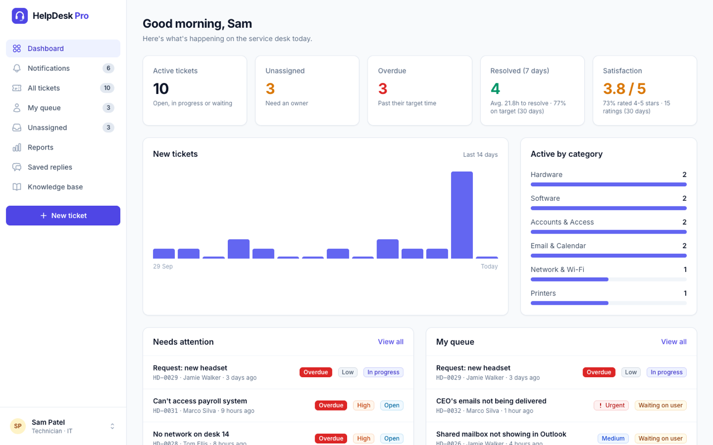
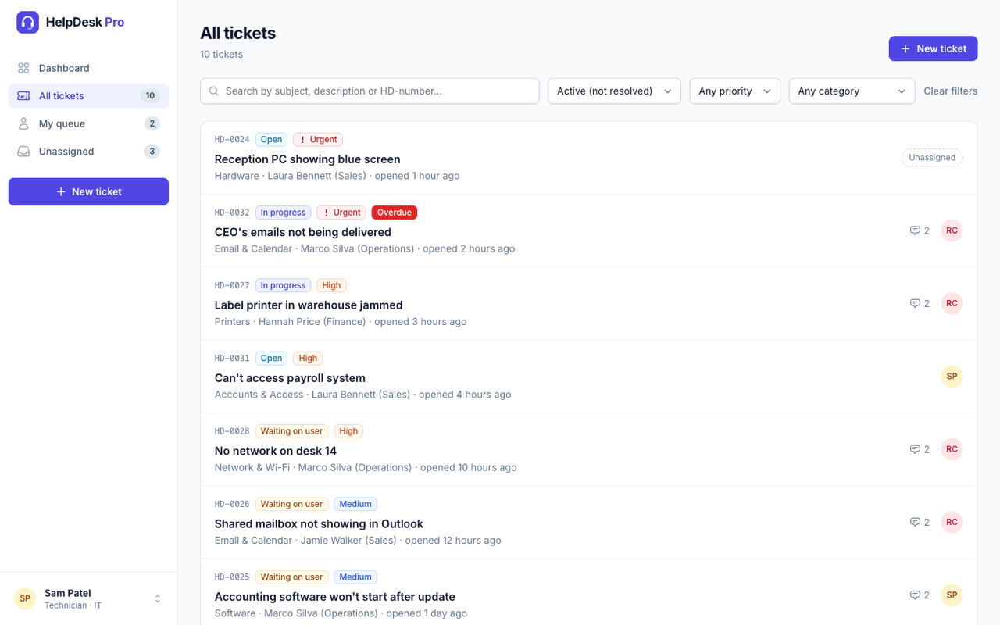
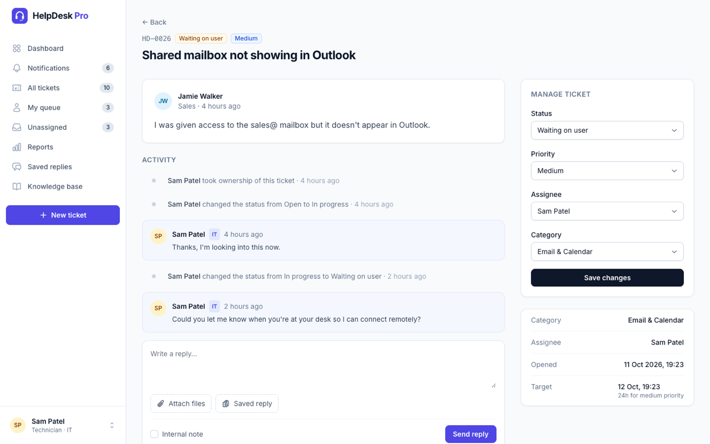
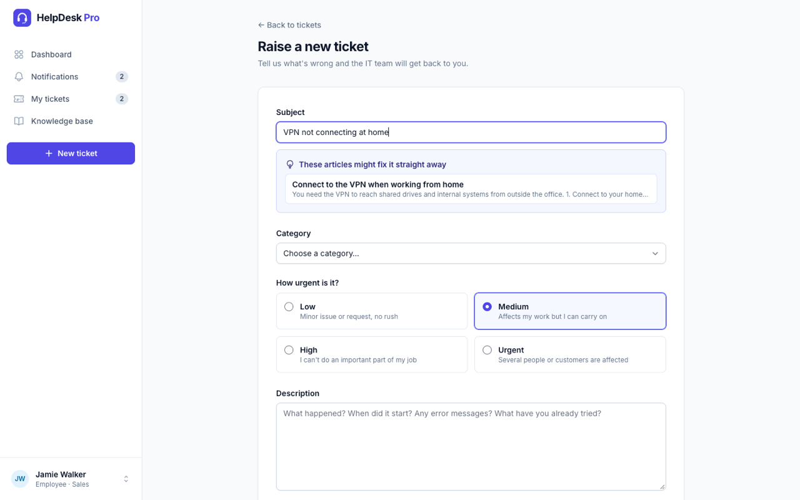
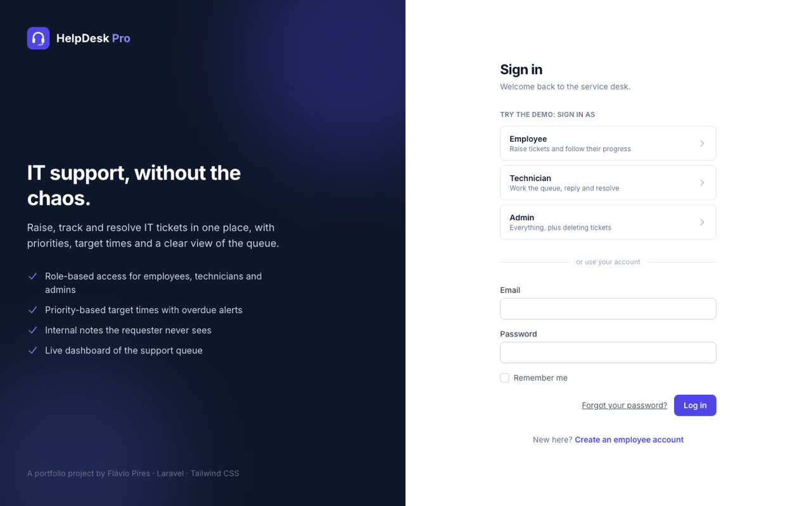

# HelpDesk Pro

[](https://github.com/FPires99/helpdesk-pro/actions/workflows/tests.yml)

An IT service desk where employees raise support tickets and the IT team works the queue, with priority-based target times, internal notes and a live dashboard.

Built with **Laravel 12**, **Blade**, **Tailwind CSS** and **Alpine.js**, and covered by automated feature tests.



## Try it

The login page has one-click demo accounts. All demo users use the password `password`.

| Role | Email | What they can do |
| --- | --- | --- |
| Employee | `employee@helpdesk.test` | Raise tickets, reply, see only their own tickets |
| Technician | `tech@helpdesk.test` | See every ticket, assign, change status/priority, write internal notes |
| Admin | `admin@helpdesk.test` | Everything a technician can do, plus delete tickets |

## Features

- **Three roles with enforced permissions.** Employees only ever see their own tickets; staff see the whole queue. Rules live in a [policy](app/Policies/TicketPolicy.php) and are checked on every request.
- **Ticket lifecycle.** Open → In progress → Waiting on user → Resolved → Closed, with `resolved_at` tracked automatically.
- **Priority-based target times (SLA).** Urgent 2h, High 8h, Medium 24h, Low 72h. Overdue tickets are flagged, and the clock pauses while a ticket is waiting on the user.
- **Smart replies.** When the requester replies, a ticket that was *waiting* goes back to *in progress*, and a *resolved* ticket is reopened.
- **Internal notes** that only IT staff can read or write, highlighted in the conversation.
- **"Assign to me"** to take ownership of a ticket in one click.
- **Search and filters**: search by text or ticket number (`HD-0042`); filter by status, priority and category.
- **Dashboard for IT staff**: active, unassigned and overdue counts, resolution time, % resolved on target, new tickets per day and active tickets by category.
- **Employee dashboard** showing what is open and what is waiting on them.
- **Responsive** layout that works on phones.
- **Realistic demo data**: a fictional company with 11 users and 32 tickets based on everyday IT support issues (account lockouts, VPN, printers, phishing reports, MFA resets…).

## Screenshots

| Ticket queue | Ticket conversation |
| --- | --- |
|  |  |

| Raising a ticket | Sign in with demo accounts |
| --- | --- |
|  |  |

## Running it locally

Requirements: PHP 8.2+, Composer and Node.js 18+.

```bash
git clone https://github.com/FPires99/helpdesk-pro.git
cd helpdesk-pro
composer install
npm install && npm run build
cp .env.example .env
php artisan key:generate
touch database/database.sqlite
php artisan migrate --seed
php artisan serve
```

Open http://127.0.0.1:8000 and pick a demo account.

It uses SQLite by default. To use MySQL, set `DB_CONNECTION=mysql` and the `DB_*` settings in `.env`. To hide the demo accounts on a real deployment, set `HELPDESK_DEMO=false`.

## Tests

```bash
php artisan test
```

The feature tests in [`tests/Feature`](tests/Feature) cover the access rules (who can see, edit, assign, delete and write internal notes), status changes, SLA logic, search, and that every page renders for each role.

## How it's built

| Area | Where |
| --- | --- |
| Roles, statuses, priorities and target times | [`app/Enums`](app/Enums) (PHP enums) |
| Data model and relationships | [`app/Models`](app/Models) |
| Permissions | [`app/Policies/TicketPolicy.php`](app/Policies/TicketPolicy.php) |
| Validation | [`app/Http/Requests`](app/Http/Requests) |
| Controllers | [`app/Http/Controllers`](app/Http/Controllers) |
| Views and components | [`resources/views`](resources/views) |
| Demo data | [`database/seeders/DatabaseSeeder.php`](database/seeders/DatabaseSeeder.php) |

## Roadmap

- Email notifications when a ticket is assigned or updated
- File attachments (screenshots of errors)
- Knowledge base of common fixes, suggested while raising a ticket
- CSV export and monthly reports

---

Built by [Flávio Pires](https://fpires99.github.io/personal_website/).
